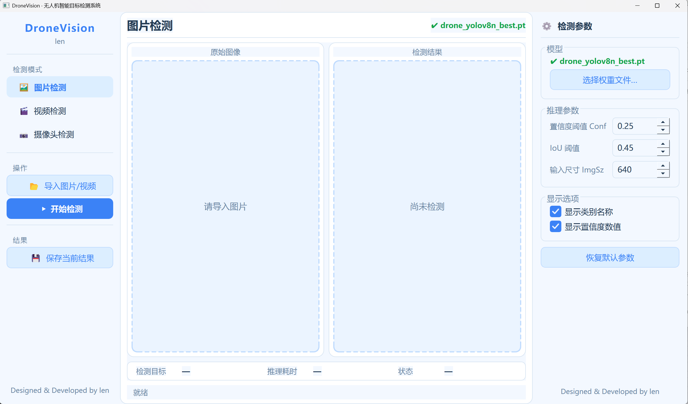
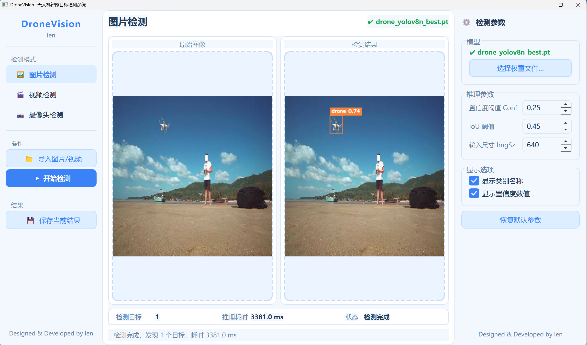
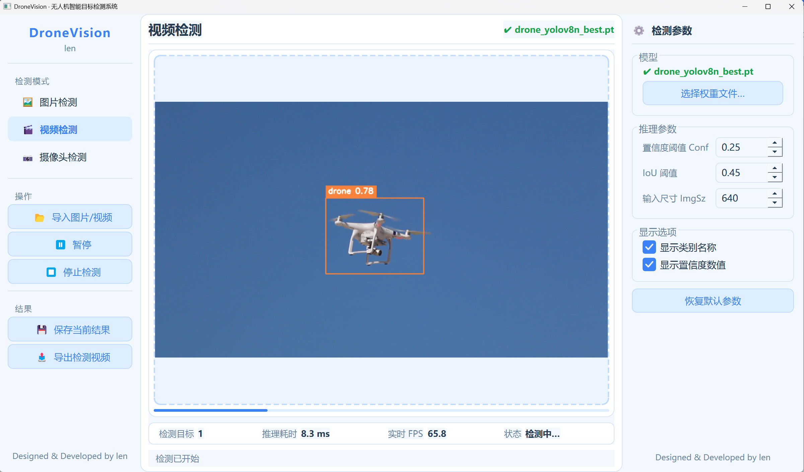
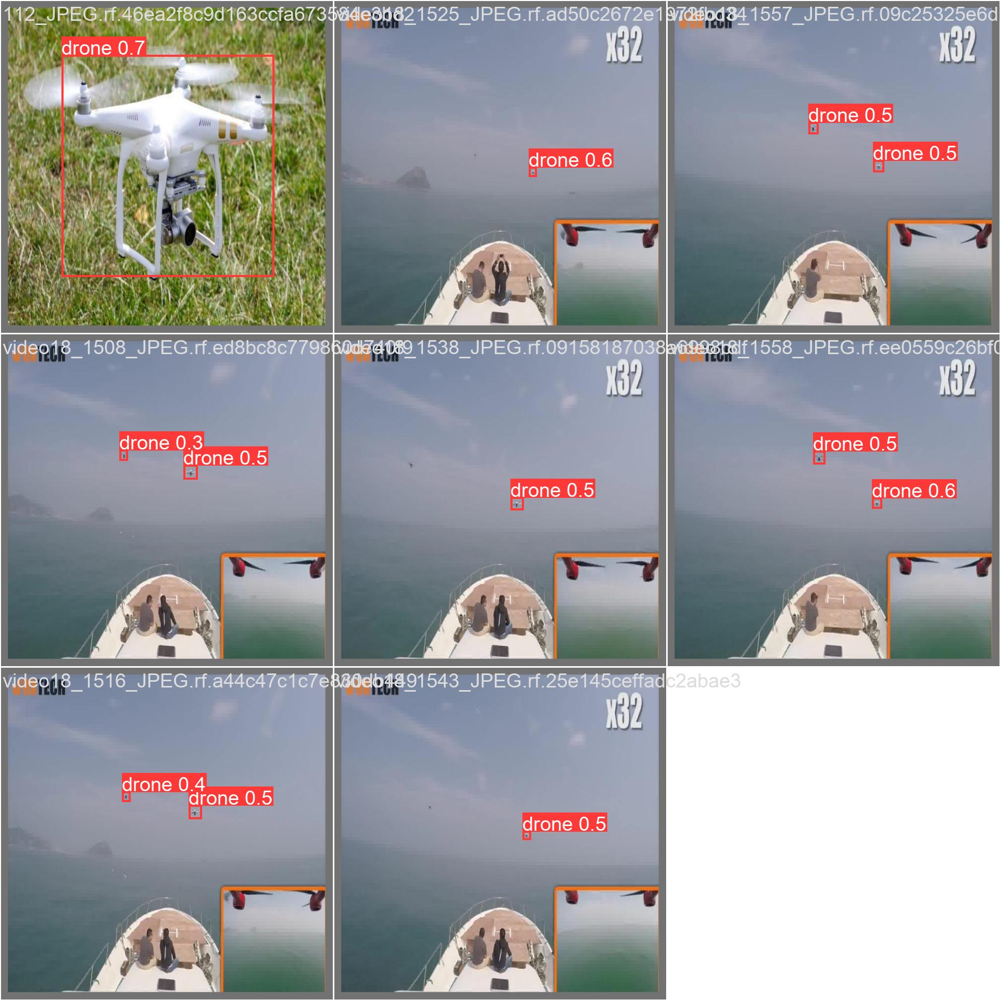
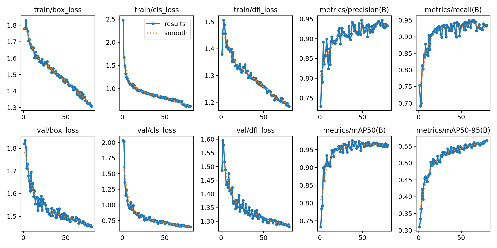
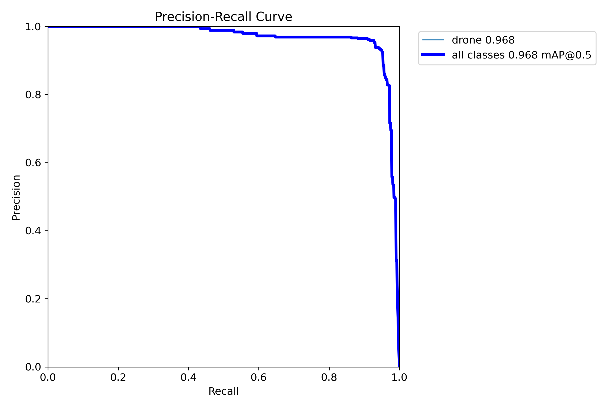
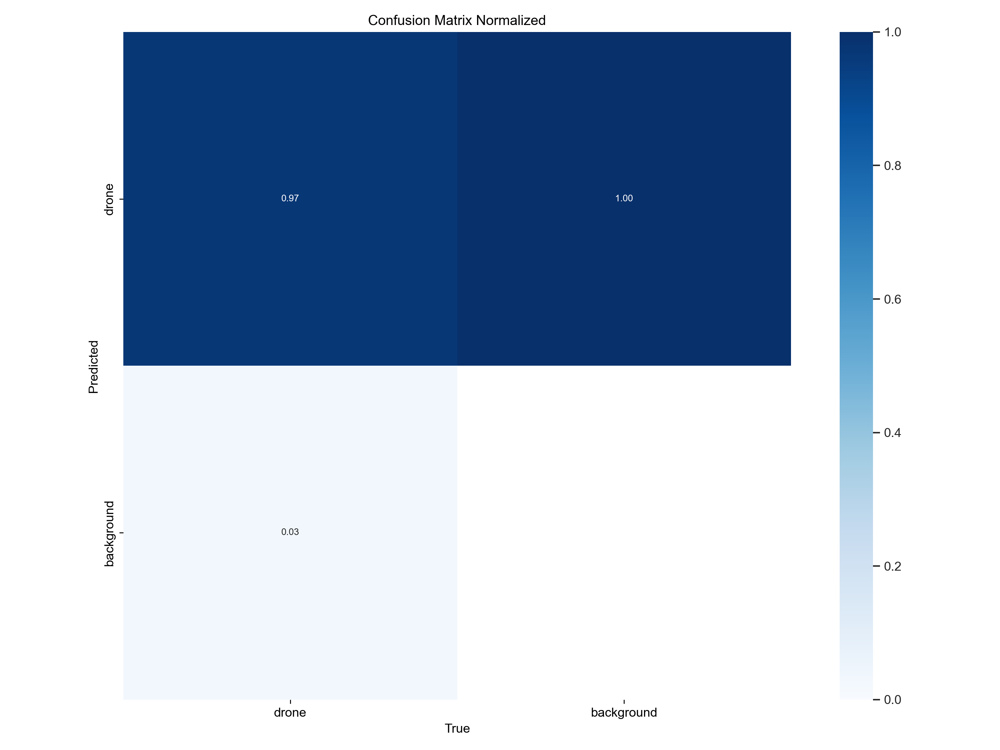
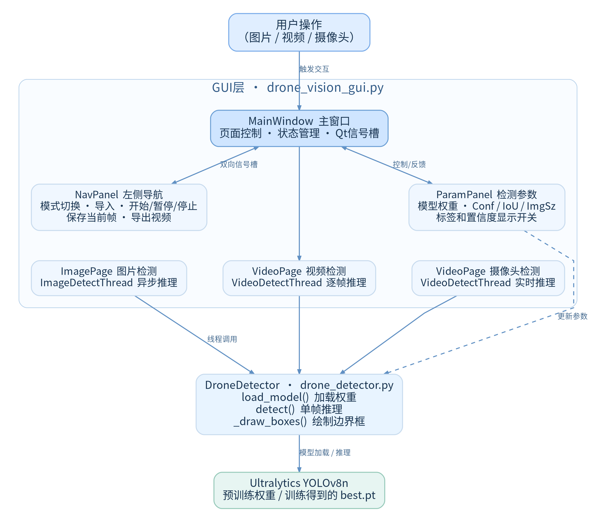
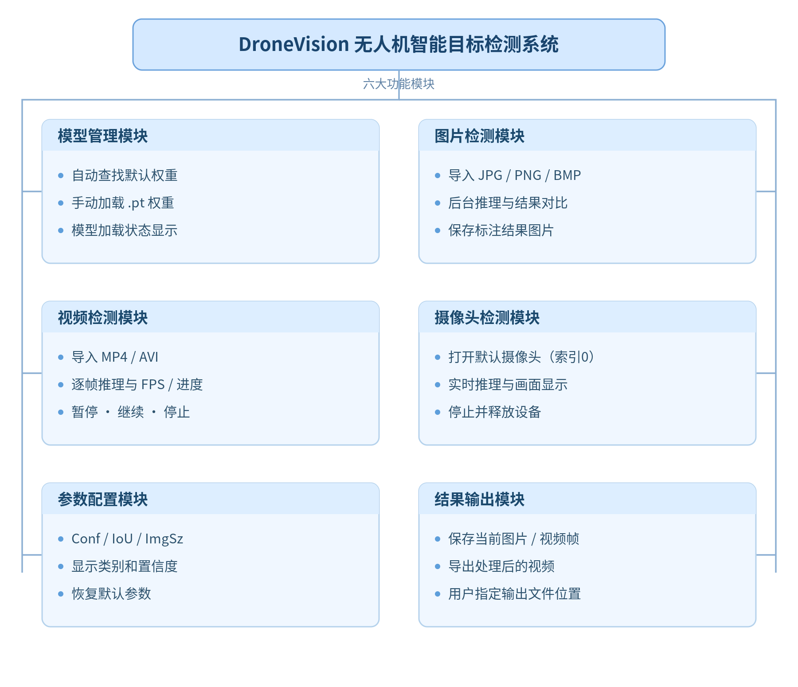

# DroneVision

<p align="center">
  <strong>基于 YOLOv8n 与 PyQt5 的无人机目标检测系统</strong>
</p>

<p align="center">
  <code>Python 3.9</code> · <code>YOLOv8n</code> · <code>PyTorch</code> · <code>PyQt5</code> · <code>OpenCV</code> · <code>Windows</code> · <code>AGPL-3.0</code>
</p>

DroneVision 是一个面向 Windows 桌面的单类别无人机检测系统。项目使用公开数据集训练 YOLOv8n 模型，通过 PyQt5 提供图片、视频和摄像头三种输入模式，并实现多线程推理、参数调整、结果保存与 PyInstaller onedir 部署。

## 软件界面展示

<p align="center">
  
</p>

<p align="center">DroneVision 桌面软件主界面，采用三栏式布局，集成检测模式切换、画面展示、模型管理及推理参数调整。</p>

### 检测运行效果

<table>
  <tr>
    <td width="50%" align="center"></td>
    <td width="50%" align="center"></td>
  </tr>
  <tr>
    <td align="center"><strong>图片检测</strong><br>展示原始图像、检测框及目标数量。</td>
    <td align="center"><strong>视频检测</strong><br>展示视频逐帧识别、检测框及运行状态。</td>
  </tr>
</table>

## 核心功能

| 模块 | 功能 |
| --- | --- |
| 图片检测 | 导入常见图片格式，执行目标定位并显示目标数量与推理耗时；支持保存检测结果。 |
| 视频检测 | 逐帧推理并显示处理进度；支持暂停、继续、停止、当前帧截图和 MP4 结果导出。 |
| 摄像头 | 打开默认摄像头、显示实时画面并保存当前帧截图；尚无摄像头实拍无人机识别的验证证据。 |
| 参数调整 | 在界面中设置置信度阈值 `Conf`、NMS 阈值 `IoU`、输入尺寸 `ImgSz`，并控制标签与置信度显示。 |
| 模型管理 | 启动时加载 `models/drone_yolov8n_best.pt`，也可手动切换其他 `.pt` 权重。 |
| Windows 部署 | 使用 PyInstaller onedir 方式生成无控制台窗口的 Windows EXE。 |

## 模型训练与实验结果

项目以 Ultralytics YOLOv8n 预训练权重为起点完成迁移学习。数据集只有 `drone` 一个类别，共 2863 张图片；训练 80 轮，输入尺寸为 640，batch size 为 8。

| 数据划分 | 图片数量 | 用途 |
| --- | ---: | --- |
| 训练集 | 2005 | 参数学习 |
| 验证集 | 573 | 每轮验证与权重选择 |
| 独立测试集 | 285 | 训练完成后的独立评估 |
| **合计** | **2863** | 单类别无人机数据集 |

独立测试集包含 285 张图片、323 个标注实例。以下指标来自 `best.pt` 在独立测试集上的评估，不与训练过程中的验证集结果混用。

| 指标 | 结果 |
| --- | ---: |
| Precision | **93.83%** |
| Recall | **93.19%** |
| mAP@0.5 | **96.78%** |
| mAP@0.5:0.95 | **57.94%** |

### 更多检测样例

下图为自训练权重在公开测试样例上的真实预测结果，展示了近距离目标、远距离小目标和多目标场景。图片来自项目所用 Public Domain 数据集，不是合成示意图。

<p align="center">
  
</p>

### 训练过程

训练损失整体下降，验证集 mAP@0.5 在第 38 轮达到 0.97572；第 80 轮验证集 mAP@0.5 和 mAP@0.5:0.95 分别为 0.96329、0.56695。

<p align="center">
  
</p>

### 独立测试集 PR 曲线

<p align="center">
  
</p>

<details>
<summary>更多评估结果</summary>

归一化混淆矩阵来自独立测试集评估目录。单类别检测中的 `background` 行列用于表示漏检和误检，不应将该图直接解释为分类 Accuracy。

<p align="center">
  
</p>

</details>

## 系统架构与技术实现

<p align="center">
  
</p>

- **界面层**：PyQt5 负责输入模式切换、参数设置、结果展示和文件保存。
- **检测服务**：`DroneDetector` 统一封装 YOLO 模型加载、单帧推理与检测框绘制，图片、视频和摄像头共用同一套检测接口。
- **线程模型**：图片和连续帧推理运行在 `QThread` 工作线程，主线程只处理界面更新与用户交互，避免推理阻塞 GUI。
- **连续帧状态**：视频和摄像头线程支持暂停、继续与停止；Session ID 用于过滤旧线程延迟到达的信号，减少切换输入源时的状态污染。
- **媒体处理**：OpenCV 负责图像读取、视频解码、摄像头采集、结果绘制与 MP4 编码。
- **资源定位**：源码运行时使用项目相对路径；冻结运行时通过 PyInstaller 的资源目录定位模型，输出写入用户文档目录。

<details>
<summary>功能模块图</summary>

<p align="center">
  
</p>

</details>

## 项目结构

```text
DroneVision-YOLOv8-PyQt5/
├── drone_vision_gui.py          # PyQt5 主界面、工作线程与状态管理
├── drone_detector.py            # 模型加载、推理与检测框绘制
├── train_drone.py               # 训练与独立测试集评估脚本
├── DroneVision.spec             # PyInstaller onedir 配置
├── requirements.txt             # GUI、视觉与 Ultralytics 依赖
├── models/
│   ├── drone_yolov8n_best.pt    # 自训练无人机检测权重
│   └── yolov8n.pt               # YOLOv8n 迁移学习起点
├── dataset/
│   ├── data.yaml                # 相对路径数据配置
│   └── data.yaml.example
├── assets/                      # README 图片与实验图表
├── docs/DroneVision/            # 架构图和流程图源文件
├── packaging/                   # Windows 构建脚本与打包说明
├── test_images/                 # 公开数据集测试样例
└── vis_samples/                 # 可视化样例
```

完整训练数据、运行输出、构建产物和来源不明确的测试视频均由 `.gitignore` 排除。

## 快速开始

### 运行环境

- Windows 10/11
- Python 3.9
- 已验证组合：PyTorch 2.2.0、Torchvision 0.17.0、CUDA 11.8、Ultralytics 8.2.19
- CPU 环境也可运行推理，但速度取决于设备性能

### 安装与启动

```bash
git clone https://github.com/len03echo/DroneVision-YOLOv8-PyQt5.git
cd DroneVision-YOLOv8-PyQt5

# NVIDIA GPU：按 PyTorch 官方索引安装 CUDA 11.8 构建
pip install torch==2.2.0 torchvision==0.17.0 --index-url https://download.pytorch.org/whl/cu118

# 安装其余依赖
pip install -r requirements.txt

# 启动桌面程序
python drone_vision_gui.py
```

GUI 启动后默认加载：

```text
models/drone_yolov8n_best.pt
```

运行 GUI 不需要下载完整训练数据集；仓库中的自训练权重可直接用于推理。若不使用 NVIDIA CUDA，请根据 [PyTorch 官方安装说明](https://pytorch.org/get-started/locally/) 选择对应的 CPU 或其他构建。

### 重新训练

1. 从 [Roboflow Universe](https://universe.roboflow.com/drone-object-detection-ckzef/drone-object-detection-5twsu/dataset/1) 下载 Drone Object Detection v1 数据集。
2. 按 `dataset/train`、`dataset/valid`、`dataset/test` 组织数据，每个目录包含 `images/` 与 `labels/`。
3. 确认 `dataset/data.yaml` 中的相对路径保持有效。
4. 运行训练脚本：

```bash
python train_drone.py
```

脚本默认使用 GPU 0、训练 80 轮，并在训练后调用 `split="test"` 对独立测试集评估。可通过 `--epochs`、`--batch`、`--device`、`--model`、`--project` 等参数覆盖默认值。

## Windows EXE 部署

先安装 PyInstaller 及其社区 hooks，然后在项目根目录执行：

```bat
pip install pyinstaller pyinstaller-hooks-contrib
python -m PyInstaller DroneVision.spec --noconfirm --clean
```

也可以使用仓库中的构建脚本：

```bat
packaging\build.bat
```

构建产物位于 `dist\DroneVision\`。这是 onedir 应用，分发时必须保留 `DroneVision.exe`、`_internal` 及同目录中的全部依赖，不能只复制 EXE。完整 CUDA 构建会包含 PyTorch、CUDA 和 cuDNN 运行库，目录体积可能达到数 GB，因此 GitHub 源码仓库不直接包含 `dist/`。

`DroneVision.spec` 使用 PyInstaller 与 `pyinstaller-hooks-contrib` 提供的标准 Torch、Torchvision 和 Ultralytics hooks，不再加载会覆盖标准行为的项目自定义 hooks。详细说明见 [`packaging/README_packaging.md`](packaging/README_packaging.md)。

## 数据集、许可证与致谢

### 数据与权重

- 数据集：[Drone Object Detection v1](https://universe.roboflow.com/drone-object-detection-ckzef/drone-object-detection-5twsu/dataset/1)，导出文件标注为 Public Domain。
- `test_images/`、`vis_samples/` 和 README 检测样例来自上述公开数据集。
- `models/yolov8n.pt` 为 Ultralytics YOLOv8n 预训练权重；`models/drone_yolov8n_best.pt` 为本项目基于公开数据集训练得到的权重。
- `test_videos/` 中本地视频来源与再分发授权不明确，已由 `.gitignore` 排除，不属于公开仓库内容。

### 许可证

本项目源代码按 **GNU AGPL-3.0** 发布，完整条款见 [`LICENSE`](LICENSE)。项目未改用 MIT 许可证。

| 组件 | 许可证说明 |
| --- | --- |
| Ultralytics YOLOv8 | AGPL-3.0；如不满足开源义务，需按 Ultralytics 的许可方案另行授权。 |
| PyQt5 | GPL-3.0 或 Riverbank 商业许可；PyQt5 本身不采用 LGPL。 |
| PyTorch / Torchvision | BSD-3-Clause。 |
| OpenCV 4.9.0 | Apache-2.0；`opencv-python` 打包脚本采用 MIT，wheel 还包含具有各自许可证的第三方组件。 |
| NumPy | BSD-3-Clause。 |
| PyInstaller | GPL-2.0-or-later，并附允许构建和分发其他许可程序的打包例外。 |

分发源码、权重或 EXE 前，请同时核对相关依赖、模型和二进制发行包所附的完整许可文件。本节仅记录项目采用的许可信息，不构成法律意见。

### 致谢

感谢 [Ultralytics](https://github.com/ultralytics/ultralytics)、[PyTorch](https://pytorch.org/)、[OpenCV](https://opencv.org/)、[Riverbank Computing](https://www.riverbankcomputing.com/software/pyqt/) 与公开数据集贡献者提供的工具和资源。

